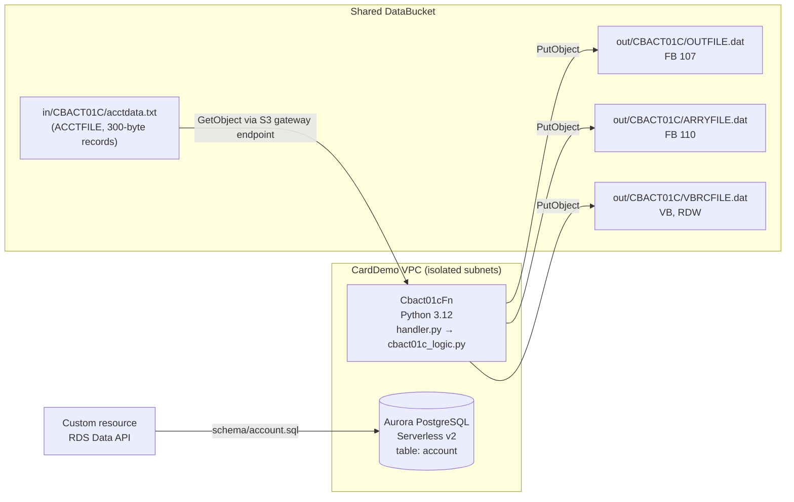

# CBACT01C: account extract (Lambda)

Migration of `app/cbl/CBACT01C.cbl` (JCL `READACCT`) to a Python 3.12 Lambda in the shared `CardDemoStack`. For business rules, how the original was run, and discrepancies, see [ANALYSIS.md](ANALYSIS.md).

## Architecture



| COBOL | AWS |
|---|---|
| `ACCTFILE` VSAM KSDS | `s3://<DataBucket>/in/CBACT01C/acctdata.txt` (key order is restored by sorting on `ACCT-ID`) |
| `OUTFILE` / `ARRYFILE` / `VBRCFILE` | `s3://<DataBucket>/out/CBACT01C/{OUTFILE,ARRYFILE,VBRCFILE}.dat` |
| SYSOUT | CloudWatch Logs |
| `CVACT01Y` account record | `account` table in the shared Aurora cluster (`schema/account.sql`) |

The Lambda takes an optional `input_key` in the event (default `in/CBACT01C/acctdata.txt`). Its IAM grants are read on `in/CBACT01C/*` and put on `out/CBACT01C/*` only.

## Layout

| Path | Contents |
|---|---|
| `src/cbact01c_logic.py` | Pure business logic, bytes in and bytes out (no AWS) |
| `src/handler.py` | Lambda entry point: S3 read and write |
| `cobol_harness/` | GnuCOBOL runner for the original program, plus stand-ins for `COBDATFT` (HLASM) and `CEE3ABD` (IBM LE) and a KSDS loader |
| `golden/` | Output of the original COBOL on `app/data/ASCII/acctdata.txt` |
| `golden/edge/` | Output of the original COBOL on `tests/fixtures/edge_accounts.txt` |
| `schema/account.sql` | Aurora DDL |
| `tests/` | Parity, unit, and handler tests |

## Running

```bash
# Regenerate golden files from the original COBOL (needs GnuCOBOL)
modernized/CBACT01C/cobol_harness/run_cobol.sh
modernized/CBACT01C/cobol_harness/run_cobol.sh \
  modernized/CBACT01C/tests/fixtures/edge_accounts.txt modernized/CBACT01C/golden/edge

# Tests
cd modernized/CBACT01C
python3.12 -m venv .venv && .venv/bin/pip install -r requirements-dev.txt
.venv/bin/python -m pytest -v

# Infra
cd modernized/infra && npm run build && npm test && npx cdk synth -q
```

## Test results

From a clean checkout of this branch:

- **Parity, unit, and handler tests (pytest): 16 passed, 0 failed.**
  - The OUTFILE and ARRYFILE bytes match the original COBOL exactly, for both the sample set (50 accounts) and the edge set (4 accounts).
  - VBRCFILE's logical records (length and content) match for both sets.
  - The handler test checks the S3 keys and that the OUTFILE it writes matches the golden file.
- **CDK (jest): 6 passed, 0 failed.** `cdk synth -q` succeeds.

## Known differences from the COBOL

Details are in [ANALYSIS.md](ANALYSIS.md#discrepancies-and-limitations).

- VBRCFILE uses z/OS RDWs, where the length includes the 4-byte header. GnuCOBOL's header length excludes it. The parity test compares logical records.
- The Lambda's log output is not a copy of the COBOL SYSOUT field dump.
- A known COBOL quirk is reproduced on purpose: for accounts with a non-zero `ACCT-CURR-CYC-DEBIT`, the OUTFILE debit is carried over from the previous record (R4b).
