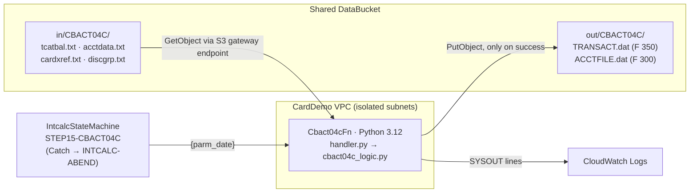

# CBACT04C: interest calculator (JCL INTCALC) on Lambda

Migration of `app/cbl/CBACT04C.cbl` (JCL `app/jcl/INTCALC.jcl`) to a Python 3.12 Lambda in the shared `CardDemoStack`, plus a Step Functions state machine that mirrors the single JCL step. Business rules, the baseline method, and known COBOL quirks are in [docs/BUSINESS_SPEC.md](docs/BUSINESS_SPEC.md).

## Architecture



| z/OS | AWS |
|---|---|
| `STEP15 EXEC PGM=CBACT04C,PARM='2022071800'` | State machine task `STEP15-CBACT04C` → `Cbact04cFn`, event `{"parm_date": "2022071800"}` (that value is also the default) |
| `TCATBALF` / `ACCTFILE` / `XREFFILE`+`XREFFIL1` / `DISCGRP` VSAM KSDS | `in/CBACT04C/{tcatbal,acctdata,cardxref,discgrp}.txt`, loaded into in-memory indexes. Key order is restored by sorting; duplicate primary keys are rejected as a KSDS load would. Each key can be overridden in the event (`tcatbal_key`, `acctdata_key`, `cardxref_key`, `discgrp_key`). |
| `TRANSACT` → `SYSTRAN(+1)` GDG | `out/CBACT04C/TRANSACT.dat`. The bucket is versioned, so each run keeps prior generations. |
| `ACCTFILE` updated in place (REWRITE) | `out/CBACT04C/ACCTFILE.dat`: the full account file after the run, in key order, 300-byte records. It can be fed back in as `acctdata_key`. |
| SYSOUT | CloudWatch Logs (same lines as the COBOL SYSOUT) |
| Abend `CEE3ABD` 999 | `CobolAbend` exception → Lambda error → `INTCALC-ABEND` Fail state |

### Decisions

- **Python 3.12 with integer arithmetic in hundredths.** This gives exact COBOL fixed-point semantics: truncation toward zero, and high-order truncation on overflow, which a receiving `PIC S9(n)V99` field does without `ON SIZE ERROR`. Floats are never used.
- **Byte-level records.** Records are kept as raw copybook-layout bytes and only the changed fields are patched, so unchanged bytes (fillers, dates) round-trip exactly.
- **All-or-nothing on abend.** On z/OS the `TRANSACT` generation is deleted but earlier account REWRITEs remain, and recovery means restoring the KSDS. The Lambda writes nothing on abend, so a rerun starts from the same inputs. The SYSOUT log and the abend code still match the COBOL.
- **S3 only for now.** Same pattern as CBACT01C. The Aurora `account` table is not touched by this job yet.
- **COBOL quirks are kept for parity**, notably that the last account is never rewritten (BUSINESS_SPEC R8).

## Layout

| Path | Contents |
|---|---|
| `src/cbact04c_logic.py` | Pure business logic, bytes in and bytes out (no AWS) |
| `src/handler.py` | Lambda entry point: S3 read and write, SYSOUT to logs |
| `cobol_harness/` | GnuCOBOL runner for the unmodified CBACT04C: PARM driver (`INTCALC.cbl`), KSDS loader (`LOADDATA.cbl`), account unloader (`UNLDACCT.cbl`), `CEE3ABD` stand-in |
| `golden/<case>/` | Original COBOL output per case: `TRANSACT.dat`, `ACCTFILE.dat`, `SYSOUT.txt`, `RC.txt` |
| `tests/fixtures/<case>/` | Inputs for the non-sample cases (the sample case uses `app/data/ASCII`) |
| `tests/` | Parity, unit, and handler tests |

## Running

```bash
# Regenerate golden files from the original COBOL (needs GnuCOBOL)
H=modernized/CBACT04C/cobol_harness/run_cobol.sh
$H                                   # sample: app/data/ASCII -> golden/sample
for c in edge empty abend_acct abend_xref abend_discgrp; do
  $H modernized/CBACT04C/tests/fixtures/$c modernized/CBACT04C/golden/$c
done

# Tests (parity tests run the real Lambda handler against an in-memory S3)
cd modernized/CBACT04C
python3.12 -m venv .venv && .venv/bin/pip install -r requirements-dev.txt
.venv/bin/python -m pytest -v

# Infra
cd modernized/infra && npm run build && npm test && npx cdk synth -q

# After deploy: upload inputs to s3://<DataBucket>/in/CBACT04C/ and start
aws stepfunctions start-execution --state-machine-arn <IntcalcStateMachineArn> \
  --input '{"parm_date": "2022071800"}'
```

`test_golden_files_are_reproducible` re-runs the COBOL for every case and compares the result with the committed golden files. It is skipped when `cobc` is not installed.
